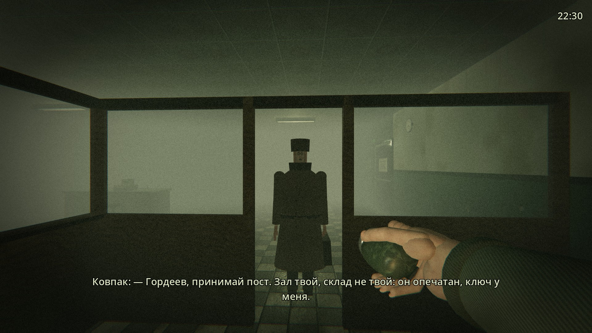
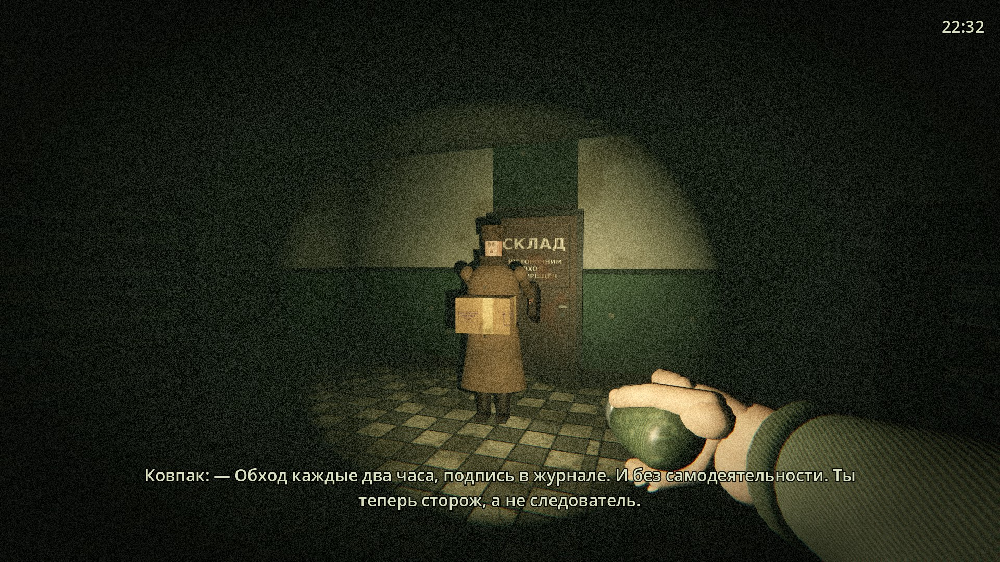
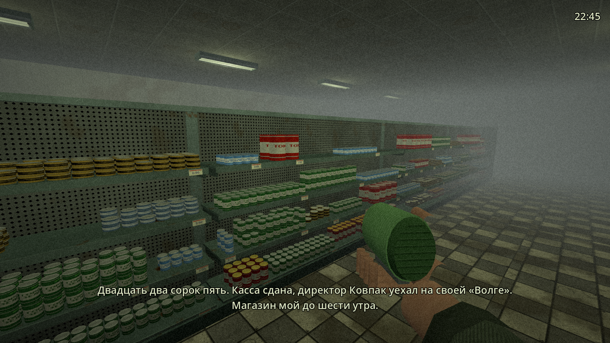
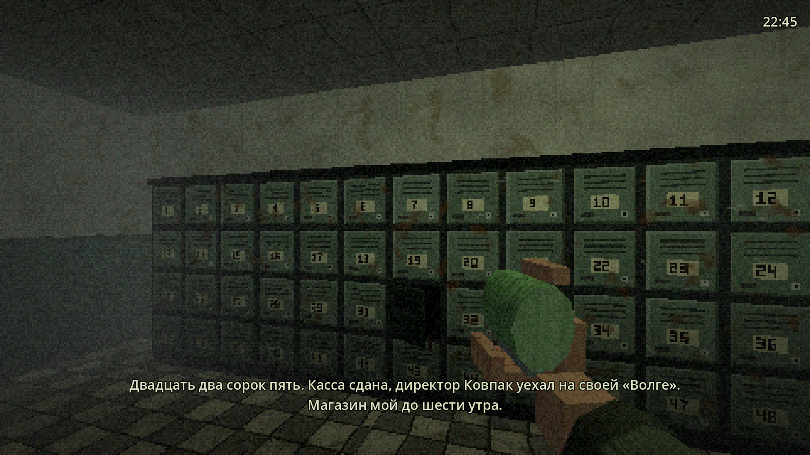
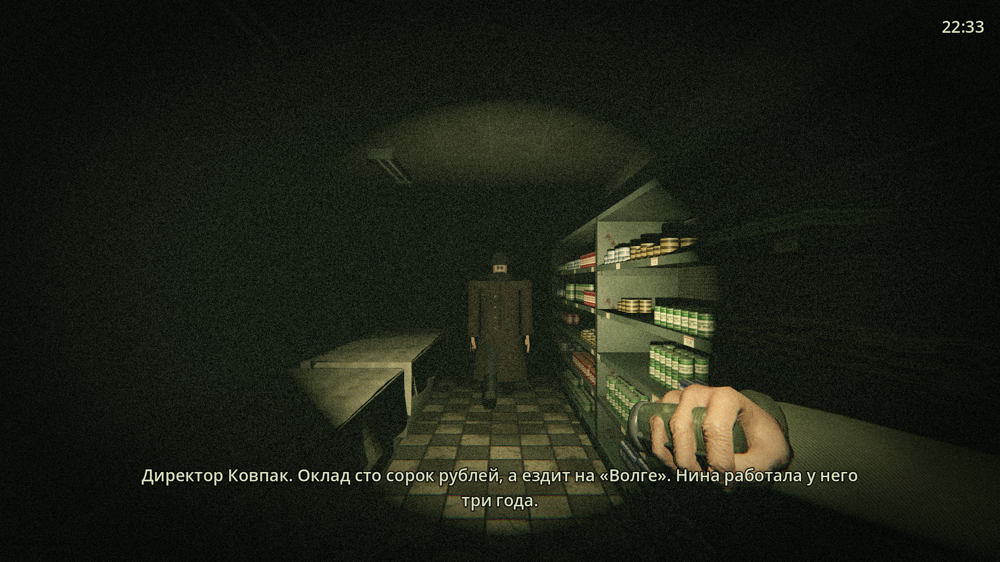
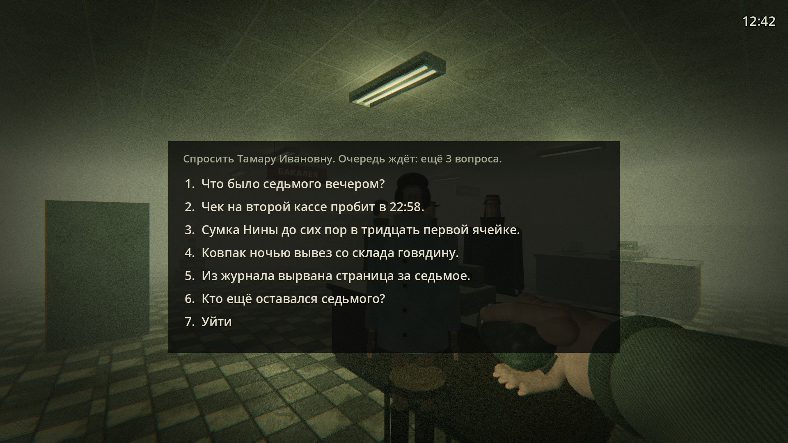
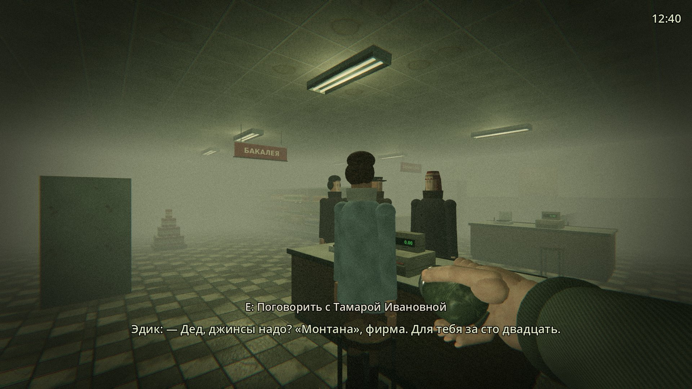
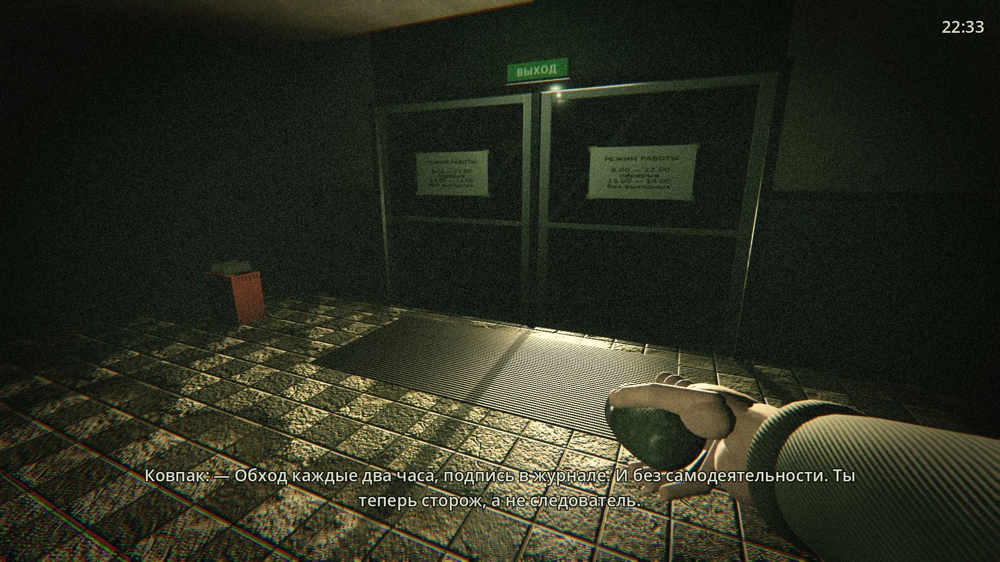
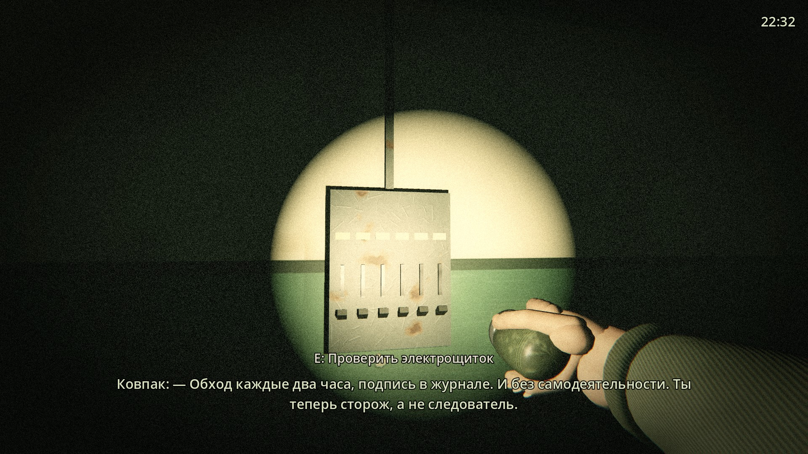
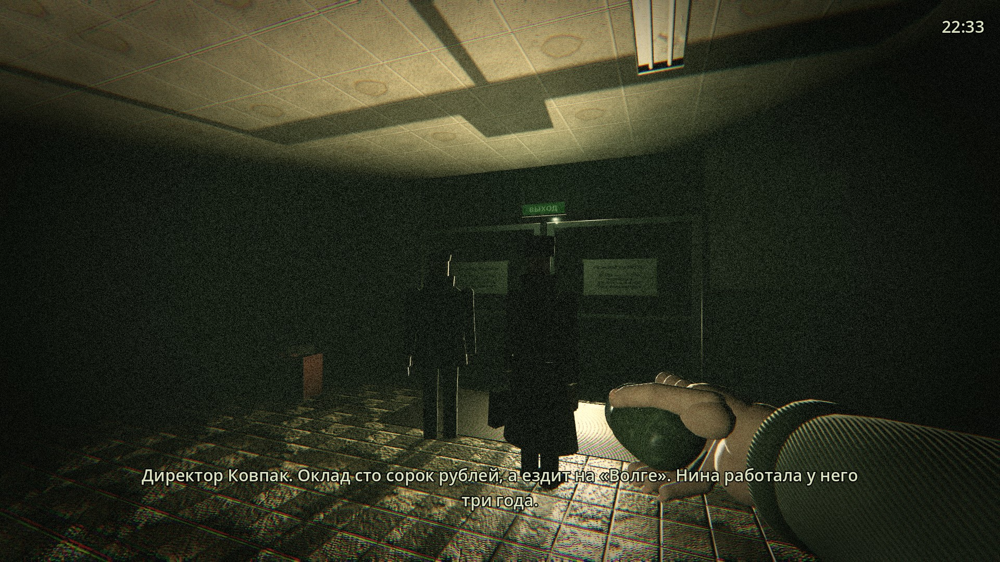

# Кировский: Закрытие

Нуар-хоррор от первого лица, картинка в духе Silent Hill 2: туман, темнота, плёночное зерно и фонарик. Свердловск, октябрь 1988 года. Сторож вневедомственной охраны Гордеев, бывший следователь, проводит пять ночных смен в универсаме «Кировский» на ЖБИ и ищет убийцу пропавшей продавщицы кулинарии Нины Лукиной. Мистики нет: убийца обычный человек с ключами от склада.

В репозитории сейчас **первая ночь целиком**: смена с 22:30 до 6:00, примерно полчаса игры. Директор сдаёт пост, свет гаснет рядами, приходит убийца, в два часа ночи возвращается директор, утром приходят грузчики.







## Как запустить

1. Скачайте [Godot 4.5](https://godotengine.org/download) (обычная версия, не .NET).
2. Откройте Godot, нажмите «Импорт» и выберите `project.godot` из этой папки.
3. Нажмите F5.

Окно Full HD (1920×1080, 16:9). Работает на рендерере Compatibility (OpenGL 3), поэтому пойдёт и на слабом ноутбуке.

## Управление

| Действие | Клавиатура | Геймпад |
|---|---|---|
| Смотреть | мышь, стрелки влево/вправо | правый стик |
| Идти, шаг в сторону | W / A / S / D | левый стик, крестовина |
| Бег (шумно) | Shift | B |
| Пригнуться (тихо, за ларём не видно) | C или Ctrl | нажать левый стик |
| Фонарик-«жучок», держать (шумно) | F или правая кнопка мыши | правый курок |
| Осмотреть, поговорить, сесть на стул | E, пробел, Enter | A |
| Блокнот (пауза) | Tab | Back / Y |
| После смерти: продолжить с последней подписи в журнале | R | Start |
| После смерти: начать ночь сначала | N | |

Вид от первого лица. Фонарик Гордеев держит в правой руке, она видна в кадре, и луч идёт из линзы фонарика туда, куда он смотрит. Пока фонарик горит, рычаг под ним качается. Esc освобождает мышь, клик по окну захватывает её снова.

## Первая ночь: пятница, 14 октября 1988

| Время | Что происходит |
|---|---|
| 22:30 | Свет ещё горит. Директор Ковпак стоит у будки и сдаёт пост: склад опечатан, лари не трогать, обход каждые два часа. Кассир Тамара Ивановна сдаёт кассу. Обоих можно расспросить (E): Ковпака про Нину, Тамару про седьмое октября. |
| 22:38 | Они уходят через стеклянные двери, Ковпак запирает снаружи, «Волга» уезжает, фары проходят по залу. |
| 22:50 | Каждые три минуты щёлкает реле, и ряд гаснет: бакалея, консервы, молочный, заморозка, задний проход, касса и вход. |
| 23:10 | Хлопает дверь склада. Убийца в магазине. |
| 23:30 | Первый обход: проверить дверь склада, электрощиток в заднем проходе и расписаться в журнале на посту. |
| 00:40 | Звонит телефон на посту. В трубке дышат. |
| 01:10 | Бакалея на секунду загорается сама: кто-то трогал рубильник. Ручка на щитке ещё тёплая. |
| 01:40 | Убийца уходит через склад и закрывает дверь за собой. |
| 01:50 | К дверям подъезжает «Волга». Ковпак своим ключом открывает магазин, велит сидеть на посту, идёт на склад и выносит тяжёлую коробку. «Меня здесь не было». У двери склада остаётся его накладная. |
| 02:20 | Второй обход. |
| 02:40 | Дверь склада снова открывается. Ковпак уехал, значит это не он. Или не только он. |
| 03:15 | В консервах падает пирамида банок. |
| 04:20 | Третий обход. |
| 05:10 | Убийца уходит до утра. |
| 06:00 | Стук в стекло. Грузчик Вася Кран и Ковпак открывают магазин и включают свет. Ковпак проверяет подписи в журнале. Итог смены: сколько найдено улик и подписано обходов. |

**Улики (пять).** Сумка Нины в ячейке № 31. Заколка под покрывалом третьего ларя в заморозке. Контрольная лента кассы № 2: чек пробит в 22:58, после закрытия. Вырванная страница журнала обходов за 7 октября. Накладная Ковпака на 40 кг говядины «без реализации» с пометкой «Р.». Всё записывается в блокнот (Tab), когда найдены все пять, Гордеев делает вывод.

**Обходы и сохранение.** Каждый обход это дверь склада, щиток и подпись в журнале. Подпись сохраняет смену: если убийца догонит, R возвращает к последней подписи, с тем же временем, найденными уликами и поднятыми покрывалами. Пропущенный обход Ковпак утром заметит.

**Убийца.** Обычный человек с ключами от склада. В темноте замечает Гордеева только вплотную, но видит издалека, если тот стоит под горящей лампой или светит фонариком. Идёт на шум: жужжание фонарика, бег, поднятое покрывало, звонок телефона. Если пригнуться (C), Гордеев идёт медленно и тихо, а за ларём его не видно. Компрессор ларя замолкает, когда убийца рядом. Насилие показано прямо.

**Ожидание.** На посту можно сесть на стул (E): время идёт в шесть раз быстрее, пока не случится что-то важное или пока вы не встанете (W/A/S/D). Но будка освещена, и из зала её видно.

## Как устроена графика

Мир рисуется в полном Full HD (1920×1080) со сглаживанием MSAA 4×. Текстуры 512×512 с плавной фильтрацией и мипмапами, надписи набраны настоящим шрифтом. Картинка сделана в духе Silent Hill 2 (только стиль, без чужих ресурсов): у кафеля, стен, ткани, кожи и металла есть рельеф, мокрый пол и хром дают блики от фонарика, цвет приглушён и уведён в грязно-зелёный, тени мутные, поверх идёт крупное зерно плёнки, лёгкое мерцание и мягкий ореол вокруг ламп. Туман густой: серый, пока горит свет, и чёрный, когда ряды гаснут.

| Приём | Где |
|---|---|
| Кадр 1920×1080, MSAA 4×, тени от фонарика | `scripts/main.gd`, `_build_view` |
| Текстуры 512×512 с фильтрацией и мипмапами | `textures/`, `tools/make_textures.py` |
| Материалы: обычный, двусторонний (ткань, корзины), стекло; карты рельефа и блики | `shaders/`, `scripts/mats.gd` |
| Детали собраны в один меш на материал: товары, кассы, лари, пост | `scripts/props.gd`, `scripts/mesh_builder.gd` |
| Цветокоррекция, ореол ламп, зерно, мерцание, виньетка, красная вспышка при ударе | `shaders/psx_post.gdshader` |
| Глубинный туман 2–12 м, в темноте 1–7,5 м и чёрный; плёночная тональная кривая | `scripts/main.gd`, `_update_env` |

Освещение попиксельное, свет от ламп и фонарика считается для каждой точки.

## Текстуры и модели

Все текстуры лежат в папке `textures/` обычными картинками PNG. Любую можно заменить своей, например фотографией кафеля или этикетки: достаточно положить файл с тем же именем и теми же пропорциями (почти все квадратные 512×512; ячейки камеры хранения 1536×512, дверь склада и стеклянная дверь 512×1024, плакаты 512×640). Godot подхватит новую картинку сам. У части текстур есть пара `<имя>_n.png`: это карта рельефа, скрипт строит её из яркости картинки. Если заменили текстуру фотографией, перерисуйте и рельеф или удалите файл `_n.png`, тогда поверхность будет гладкой.

Нарисованы они скриптом `tools/make_textures.py` (Python 3 с numpy и Pillow, шрифты DejaVu). Перерисовать все заново:

```
python3 tools/make_textures.py
```

Что нарисовано: кафель 30×30 см в шахматку с крошкой, выбоинами и трещинами, побелка с подтёками над зелёной масляной панелью, потолок «Армстронг» с пятном от протечки, крашеный металл стеллажей и перфорация, 16 этикеток (томатный сок, горошек, сгущёнка, шпроты, соль, чай, макароны, спички, берёзовый и яблочный сок, кильку, муку, сахар, цикорий, молоко), рукописные ценники, 48 пронумерованных ячеек с замками, эмаль ларя со сколами и ржавчиной, мороженые пачки в инее, льняное покрывало, дверь склада с трафаретом «ПОСТОРОННИМ ВХОД ВОСПРЕЩЁН», стеклянная дверь с режимом работы, плакаты «Пейте томатный сок» и «Хлеб — всему голова», вывески рядов, клавиши кассы, диск телефона, календарь на октябрь 1988 (1-е число — суббота), часы, лицо убийцы.

Модели строит код: на стеллажах стоят отдельные пачки, банки и консервы, с пустыми местами и длинными рядами одного товара, как в 1988 году. У ларей хромированный борт, две стеклянные крышки и покрывало со складками. У касс клавиатура, табло и весы с циферблатом. На посту стол с ящиками, дисковый телефон, радио, журнал, лампа с абажуром, термос, стекло в окнах. Убийца в длинном пальто с поднятым воротником, вязаной шапке и шарфе до глаз. Рука Гордеева — готовая реалистичная модель с костями и фото-текстурой кожи (вены, складки, ногти) из открытого проекта Godot XR Tools, авторы и лицензии в `models/hand/CREDITS.md`. Кожа переделана бледнее и старше. Пальцы согнуты вокруг фонарика по суставам, на руке шерстяной рукав с отворотом. Фонарик «жучок» из оливковой пластмассы с рифлёной вставкой, хромированным ободком, отражателем, выпуклым стеклом и лампочкой, которая загорается вместе с лучом. Пока фонарик горит, пальцы сжимают рычаг и разжимаются вместе с ним. Когда фонарик выключен, рука опускается и пропадает из кадра.

Звуки лежат в папке `sounds/` файлами WAV (44,1 кГц, 16 бит), их синтезирует скрипт `tools/make_sounds.py` (Python 3 с numpy) по физическим моделям: удар металла как набор затухающих тонов, шаг как удар каблука и перекат носка по кафелю, гул ламп как сетевые 100 Гц с дребезгом дросселя. Шагов по четыре дубля, игра чередует их. Есть гул ламп, щелчок реле, жужжание шестерёнок «жучка» с трещоткой, звонок советского телефона по российской каденции, компрессор ларя, фон пустого зала со скрипами, тяжёлые резиновые сапоги убийцы, ключи, лязг двери, удар топорика, дыхание в трубке. Всё звучит через шину «Hall» с реверберацией большого кафельного зала. Любой файл можно заменить настоящей записью с тем же именем. Перегенерировать: `python3 tools/make_sounds.py`.

## Озвучка

Озвучены все 84 реплики ночи: Гордеева, директора Ковпака, кассира Тамары Ивановны и грузчика Васи Крана. Каждая реплика звучит в тот момент, когда появляется её субтитр, и субтитр держится до конца фразы. Сейчас это **черновые голоса** Silero: у Гордеева «Евгений» (модель ru v5.5; бесплатно только для некоммерческого использования, для продажи игры нужна лицензия Silero или другой голос), состаренный под голос старика: ниже, медленнее, с лёгким дрожанием и глуховатым верхом, и обработанный под внутренний монолог (сухая комната, компрессия). Пока Гордеев говорит, звуки зала приглушаются на 7 дБ, чтобы голос было хорошо слышно. Фраза в трубку «Пост охраны, Гордеев. Слушаю» звучит вслух, с эхом зала. Ковпак говорит голосом «Айдар» (сытый баритон), Тамара Ивановна голосом «Бая», Вася Кран тоже «Айдаром», но ниже и из-за стекла, глухо. Все реплики одной громкости, -17 LUFS, тихо и разборчиво.

| Файл | Что это |
|---|---|
| `voice/script.json` | сценарий: номер реплики, текст субтитра, как её читать вслух, режиссёрская пометка для актёра |
| `voice/<номер>.ogg` | записи, по одной на реплику |
| `voice/index.json` | какой субтитр какой записью озвучен, создаётся сам |
| `scripts/voice.gd` | находит запись для субтитра |
| `tools/make_voice.py` | синтезирует черновые записи заново |

Когда будут записи актёра, их нужно назвать так же, как черновые (`n1_2245.ogg`, `clue_bag.ogg` и т. д.), положить в `voice/` поверх старых и запустить `python3 tools/make_voice.py --index-only`. Реплика без записи остаётся просто субтитром.

## День первый: суббота, 15 октября 1988

После конца ночи нажмите E, и игра перейдёт к дню. С титульного экрана можно сразу нажать 2: тогда считается, что все пять улик найдены.

12:40, свет горит, в зале очередь и шум покупателей, убийцы нет. Гордеев пришёл в выходной как покупатель. Тамара Ивановна сидит на второй кассе, у входа крутится фарцовщик Эдик с джинсами.

Тамара отвечает только на **три вопроса**, потом очередь её торопит, и она обрывает разговор. Вопрос выбирают мышью или цифрами. Какие вопросы можно задать, зависит от улик первой ночи:

| Вопрос | Нужна улика | Что узнаёт Гордеев |
|---|---|---|
| Что было седьмого вечером? | нет | Нина оставалась в магазине после десяти. |
| Чек на второй кассе в 22:58 | лента кассы | Чек пробивала сама Нина, касса была оставлена открытой. |
| Сумка в ячейке № 31 | сумка | Жетон Нина носила на шее. Ячейку открыл тот, кто его снял. |
| Ковпак вывез говядину | накладная | Мясо Рината, он делится с Ковпаком. Нина собиралась в ОБХСС. |
| Вырванная страница журнала | страница | Сторожа с той ночи вызывал участковый Колесников, потом сторож уволился. |
| Кто ещё оставался седьмого? | нет | Вася Кран, Ринат и Эдик. |

Ответы записываются в блокнот (Tab) и на итоговую карточку дня. Уйти можно через входные двери, но только после разговора. Вторая ночь будет опираться на эти показания.




## Структура

```
project.godot            настройки: окно 1920×1080, Compatibility, без AA
scenes/main.tscn         одна сцена, всё остальное строится из кода
scripts/main.gd          часы, расписание событий, смерть, сохранение по журналу, конец смены
scripts/night_one.gd     первая ночь: сюжет по минутам, Ковпак, обходы, улики, телефон, утро
scripts/day_one.gd       день первый: очередь, Эдик, три вопроса Тамаре Ивановне
scripts/npc.gd           люди, которые ходят по сценарию: Ковпак, Тамара Ивановна, Вася Кран
scripts/store.gd         планировка магазина, ряды света, лари, маршрут убийцы
scripts/player.gd        Гордеев: вид от первого лица, рука с фонариком, шум
scripts/torch_hand.gd    рука с «жучком»: хват пальцев, рычаг, рукав
models/hand/             модель руки (Godot XR Tools, CC0/MIT), текстуры кожи, позы пальцев
tools/make_hand_skin.py  перекраска кожи руки
scripts/killer.gd        убийца: обход, слух, зрение, погоня, поиск
scripts/hud.gd           часы, субтитры с озвучкой, подсказки, блокнот, титры
scripts/voice.gd         поиск записи озвучки для субтитра
voice/                   сценарий и записи озвучки Гордеева
tools/make_voice.py      черновая озвучка нейросетевым голосом
scripts/characters.gd    убийца и остальные люди: одежда, шапки, лица, руки с пальцами
scripts/props.gd         мебель: стеллажи с товаром, лари, кассы, лампы, пост
scripts/mesh_builder.gd  сборка деталей в один меш: коробки, цилиндры, тела вращения, капсулы, ткань
scripts/mesh_factory.gd  коробки с нарезанными гранями и мировыми UV
scripts/tex_factory.gd   загрузка текстур по имени
textures/                текстуры PNG 512×512 и карты рельефа _n.png, их можно заменять своими
tools/make_textures.py   скрипт, который рисует текстуры и рельеф
sounds/                  звуки WAV 44,1 кГц, их можно заменять записями
tools/make_sounds.py     скрипт, который синтезирует звуки
scripts/sfx.gd           загрузка звуков, шина с эхом зала
scripts/mats.gd          материалы: рельеф, блеск и металличность по текстуре
scripts/dev_autoshot.gd  скриптовый прогон со скриншотами
scripts/dev_nighttest.gd проверка всей ночи на ускоренных часах
scripts/dev_daytest.gd   проверка дня: Эдик, три вопроса, выход (--daytest, кадры: --shots=DIR)
shaders/                 материалы (обычный, двусторонний, стекло) и пост-эффект кадра
```

## Скриншоты для проверки

```
godot --path . -- --autoshot=/tmp/shots
```

Только крупные планы руки с фонариком: `godot --path . -- --autoshot=/tmp/shots --handshot`.

Игра сама пройдёт по постам и сохранит семнадцать кадров: Ковпак у будки, Тамара Ивановна у кассы, пост, камера хранения, кассы, полки, лари, зал со светом, зал без света, фонарик, Ковпак с коробкой, щиток, фары «Волги», утро, убийца, удар, смерть. Новые кадры лежат в `docs/screenshots/` в JPG.

Вся ночь целиком на ускоренных часах (убийца при этом слепой, Гордеев сам ходит к уликам и в журнал):

```
godot --headless --path . -- --nighttest
```





## Дальше

- Ночи 2–5: убийца смелеет, новые зоны (склад, кулинария, холодильная камера).
- Фотографии настоящих фактур (кафель, этикетки) вместо нарисованных кодом, запись звуков в универсаме.
- Ограниченный инвентарь по жетонам камеры хранения.
