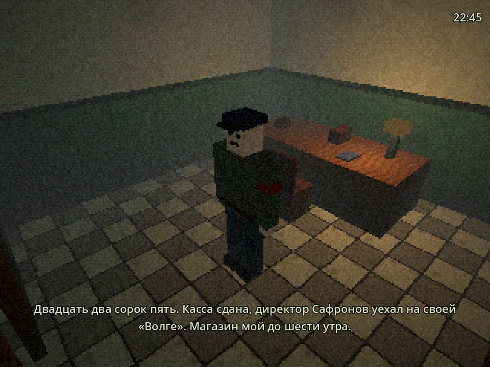
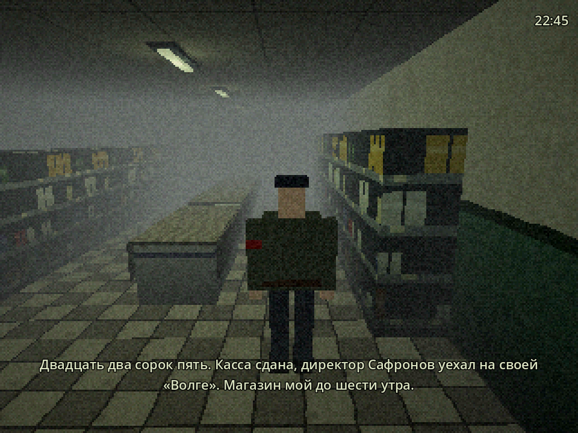
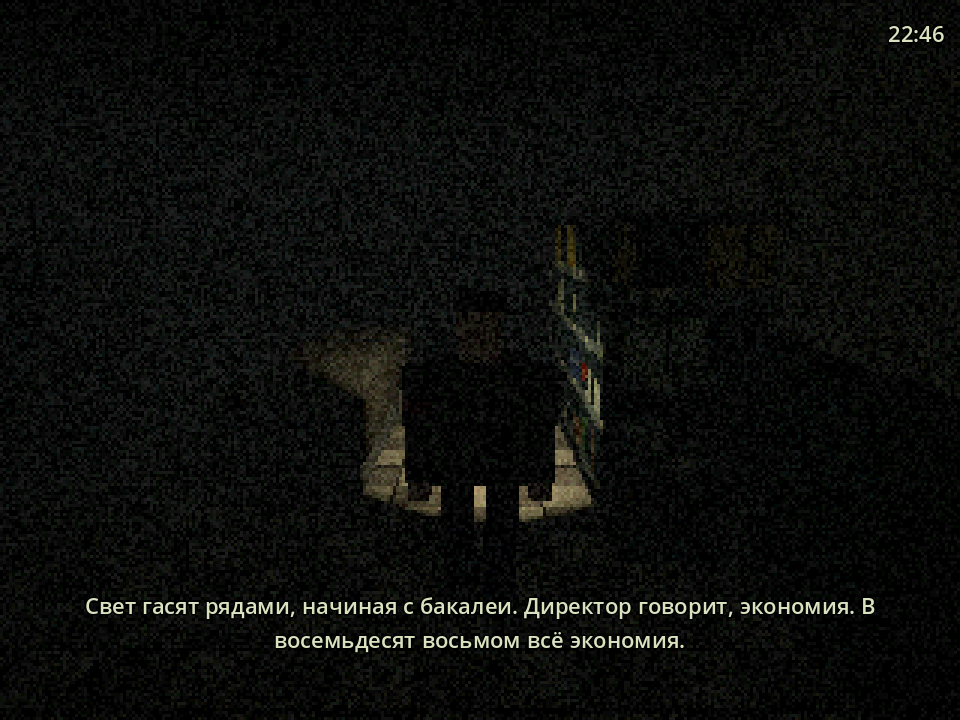

# Кировский: Закрытие

Нуар-хоррор от третьего лица в духе Silent Hill 1 (PS1). Свердловск, октябрь 1988 года. Сторож вневедомственной охраны Гордеев, бывший следователь, проводит пять ночных смен в универсаме «Кировский» на ЖБИ и ищет убийцу пропавшей продавщицы кулинарии Нины Лукиной. Мистики нет: убийца обычный человек с ключами от склада.

В репозитории сейчас **вертикальный срез**: одна сокращённая ночь, примерно десять минут игры.





## Как запустить

1. Скачайте [Godot 4.5](https://godotengine.org/download) (обычная версия, не .NET).
2. Откройте Godot, нажмите «Импорт» и выберите `project.godot` из этой папки.
3. Нажмите F5.

Работает на рендерере Compatibility (OpenGL 3), поэтому пойдёт и на слабом ноутбуке.

## Управление

| Действие | Клавиатура | Геймпад |
|---|---|---|
| Идти вперёд / назад | W / S, стрелки | левый стик, крестовина |
| Поворот на месте | A / D | левый стик |
| Бег (шумно) | Shift | B |
| Фонарик-«жучок», держать (шумно) | F или правая кнопка мыши | правый курок |
| Осмотреть | E, пробел, Enter | A |
| Блокнот (пауза) | Tab | Back / Y |
| Начать смену заново | R | Start |

Управление «танковое», как в Silent Hill 1: вперёд всегда значит туда, куда смотрит Гордеев, как бы ни стояла камера.

## Что есть в срезе

- **Три зоны магазина.** Вход с камерой хранения (48 ячеек, № 31 приоткрыта) и постом охраны (стол, дисковый телефон, журнал обходов, лампа). Кассовый узел из трёх касс. Торговый зал из четырёх рядов: бакалея, консервы, молочный и заморозка, в двух последних стоят лари под покрывалами. В конце зала задний проход и дверь склада.
- **Свет гаснет рядами.** С 22:50 каждые три игровые минуты щёлкает реле, ряд мигает и гаснет: бакалея, консервы, молочный, заморозка, задний проход, касса и вход. Туман уходит из серого в чёрный, на всю ночь остаются только дежурный свет над дверью и лампа на посту.
- **Убийца.** В 23:10 он входит через дверь склада и обходит магазин по маршруту. В темноте он замечает Гордеева только вплотную. Если тот стоит под горящей лампой или включил фонарик, убийца видит его издалека. Он идёт на шум: жужжание фонарика, бег, поднятое покрывало, звонок телефона. Если потерять его из виду, через несколько секунд он начинает искать. Насилие показано прямо: три удара топориком, кровь, тело на полу.
- **Подсказки звуком.** Компрессор ларя замолкает, когда рядом стоит убийца. Его шаги тяжелее шагов Гордеева, на обходе у него звякают ключи.
- **Три улики и запись в блокноте.** Сумка Нины в ячейке № 31, заколка под покрывалом третьего ларя в заморозке, контрольная лента кассы № 2. Осматривать в темноте можно только с фонариком. Когда найдены все три, в блокноте появляется вывод.
- **Телефон на посту.** В 00:40 он звонит, и звонок слышен на весь магазин. Если снять трубку, там молчат и дышат, а убийца в это время уходит в другую часть зала.
- **Конец смены.** В 6:00 приходят грузчики, и игра показывает, сколько улик найдено.

## Как устроена графика PS1

| Приём | Где |
|---|---|
| Кадр 320×240, без сглаживания, растянут пикселями | `scripts/main.gd`, `_build_view` |
| Дрожание вершин (привязка к сетке 320×240) | `shaders/psx_material.gdshader` |
| Аффинные текстуры без перспективной коррекции | `shaders/psx_material.gdshader` |
| Текстуры 64×64 без фильтрации, 15-битный цвет | `scripts/tex_factory.gd` |
| Грани порезаны на квадраты по 0,5 м, чтобы искажение было заметным, но не ломало картинку | `scripts/mesh_factory.gd` |
| 15-битный цвет, дизеринг Байера 4×4, зерно, виньетка | `shaders/psx_post.gdshader` |
| Глубинный туман 2–14 м, в темноте чёрный | `scripts/main.gd`, `_update_env` |
| Фиксированные ракурсы в узких местах, иначе камера за спиной | `scripts/camera_rig.gd`, `Store.camera_zones` |

Стиль повторяем мы сами: моделей, текстур и звуков Konami в проекте нет.

Освещение пока попиксельное. В Godot 4.5 на Compatibility вершинное освещение (`vertex_lighting`) почти не даёт света от SpotLight на полу, и фонарик становится бесполезным. Вернуть вершинный свет можно позже, когда пол разобьём мельче или фонарик сделаем своим шейдером.

## Плейсхолдеры

Вся графика и звук пока генерируются кодом: текстуры в `tex_factory.gd`, звуки (22 кГц, 8 бит) в `sfx.gd`, люди собраны из коробок в `characters.gd`. Настоящие модели из Blender, текстуры из Aseprite и записанные звуки заменяют их по одному, имена (`"floor"`, `"hum"`, `"phone"` и другие) остаются прежними.

Озвучки нет, монолог Гордеева идёт субтитрами.

## Структура

```
project.godot            настройки: 960×720 окно, Compatibility, без AA
scenes/main.tscn         одна сцена, всё остальное строится из кода
scripts/main.gd          ночь: часы, расписание, улики, телефон, смерть, финал
scripts/store.gd         планировка магазина, ряды света, лари, маршрут убийцы
scripts/player.gd        Гордеев: танковое управление, фонарик, шум
scripts/killer.gd        убийца: обход, слух, зрение, погоня, поиск
scripts/camera_rig.gd    камера Silent Hill
scripts/hud.gd           часы, субтитры, подсказки, блокнот, титры
scripts/characters.gd    модели людей из коробок
scripts/mesh_factory.gd  коробки с нарезанными гранями и мировыми UV
scripts/tex_factory.gd   процедурные текстуры
scripts/sfx.gd           процедурные звуки
scripts/dev_autoshot.gd  скриптовый прогон со скриншотами
shaders/                 материал PS1 и пост-эффект кадра
```

## Скриншоты для проверки

```
godot --path . -- --autoshot=/tmp/shots
```

Игра сама пройдёт по постам и сохранит восемь кадров: пост, камера хранения, кассы, зал со светом, зал без света, фонарик, убийца, смерть. Те же кадры лежат в `docs/screenshots/`.

## Дальше

- Дневной эпизод между ночами: блокнот и разговор с одним подозреваемым.
- Ночи 2–5: убийца смелеет, новые зоны (склад, кулинария, холодильная камера).
- Настоящие модели и текстуры вместо коробок, запись звуков в универсаме.
- Сохранение в камере хранения, ограниченный инвентарь по жетонам.
